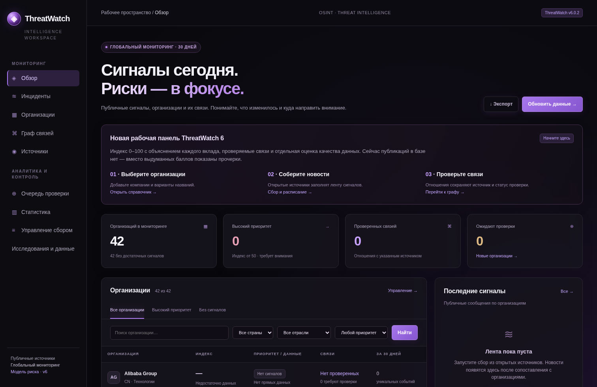

# ThreatWatch Global 6.0.2



Версия **6.0.2** видна в правом верхнем углу каждой страницы. Исправлен Windows-запуск, при котором стандартный сервер Python мог повторно привязаться к занятому порту и браузер продолжал показывать старую копию. Теперь `START_THREATWATCH.bat` получает новый свободный порт от системы, запрещает совместное использование адреса и проверяет уникальный идентификатор HTTP-сервера до открытия браузера.

Открывайте **полный адрес `VERIFIED dashboard` из нового окна запуска**, включая `/launch/…`. Старый адрес `127.0.0.1:8765` может продолжать принадлежать прежней копии. Старая база и процессы автоматически не удаляются и не завершаются.

Файлы релиза проверяются по `RELEASE_MANIFEST.json`: при неполной или смешанной распаковке desktop сообщает о несовпавшем файле и не запускает веб-сервер. Настраиваемые справочники, база, `.env` и bytecode в эту проверку не входят. Манифест защищает от ошибок распаковки, а не является цифровой подписью. Для разработки из намеренно изменённых исходников используйте checkout без манифеста.

Русскоязычное приложение для мониторинга публичных киберсигналов, организаций и их связей. Читает новости и открытые агрегаторы, сохраняет источники, предлагает новые организации и помогает расставлять приоритеты проверки.

## Запуск

Требуется Python 3.11 или новее. На Windows запустите `START_THREATWATCH.bat`. На Linux/macOS:

```sh
sh setup.sh
sh start_linux_mac.sh
```

Для `start_linux_mac.sh` / команды `serve` по умолчанию используется порт **8765**. Windows-лаунчер и команда `desktop` используют новый свободный порт, проверяют сервер и открывают браузер автоматически. Затем начинается сбор и включается шестичасовое расписание. В разделе «Управление сбором» можно управлять сбором вручную. Расписание работает, пока приложение запущено.

Для ручного запуска:

```sh
.venv/bin/python -m threatwatch init
.venv/bin/python -m threatwatch run
.venv/bin/python -m threatwatch serve
```

ИИ не требуется и выключен по умолчанию. Настоящие новости загружаются из сети; чистая установка не содержит придуманных атак. Имеющийся каталог — 42 организации из 14 стран; это стартовый список, а не полный охват мира. Добавляйте организации и варианты названий в интерфейсе. Изменения справочника повторно сопоставляют сохранённые публикации без повторной загрузки.

## Что изменилось

- Новый интерфейс: поиск и фильтры, приоритеты, источники сигналов, понятное состояние сбора, карточка организации и граф отношений.
- Кириллица, китайские и японские названия больше не удаляются при сопоставлении. Поиск новостей учитывает выбранный язык, а не всегда Францию.
- Новый индекс 0–100 с объяснением каждого компонента. Свежие прямые угрозы, заявления и сообщения об инцидентах учитываются отдельно; баллы затухают со временем. Одна история, её перепечатки и разные классификации не должны многократно повышать риск.
- Проверка публикации и число издателей влияют на уверенность в данных, а не прибавляют риск. «Нет данных» не заменяется нулём. Синтетические записи исключены из новой оценки.
- Явные упоминания организации как исследователя или источника предупреждения исключаются из прямых сигналов узкой эвристикой. Это снижает ложные оценки для поставщиков ИБ, но не заменяет ручную проверку роли каждой компании в статье.
- Подтверждённые отношения и отраслевой фон показаны отдельно и имеют ограниченный вклад. Общее упоминание и сходство отрасли не считаются доказанными деловыми отношениями.
- Предложения Wikidata сохраняются, даже когда связанная организация ещё в очереди. Её одобрение не подтверждает автоматически само отношение.
- Явные формулировки о дочерних компаниях, поставщиках и завершённых приобретениях в сохранённых новостях создают предложения отношений с URL и цитатой. Они требуют отдельной проверки; простое упоминание рядом не создаёт деловую связь.
- Восстановление упущенных связей статьи с организациями: `.venv/bin/python -m threatwatch repair-links`.

## Как читать оценку

Это **эвристический индекс приоритета мониторинга**, не процент и не доказанный прогноз взлома. Прямые сигналы дают до 75 баллов, контекст подтверждённых отношений — до 15, отраслевой фон — до 10. Угрозы имеют больший вес, чем уже случившиеся инциденты или непроверенные заявления. У событий есть временное затухание и убывающий вклад. Точные правила находятся в `threatwatch/scoring.py` и разделе «Методология».

Карточка показывает публикации, их даты и статус проверки, вклад компонентов, сведения о связанных организациях и состояние источников. Ошибка источника не означает отсутствие угрозы. Подтверждение публикации аналитиком не означает подтверждение факта взлома.

Чтобы выдавать обоснованную вероятность события на ближайшие 14–30 дней, нужны независимая историческая разметка, корректные отрицательные примеры и проверка на будущих относительно обучения данных. В архиве таких данных нет; качество прогноза этой версией не заявляется. Исследовательские команды исторической оценки сохранены, см. `README_RU.md`.

## Новости и отношения

Управляйте источниками и регионами в интерфейсе. По умолчанию активны 8 глобальных источников, языковые поиски можно включить отдельно. Google News и отдельные издатели могут возвращать ошибки или ограничивать частоту запросов. Проверяйте состояние источников, а не только количество новостей. Название страны в новостном запросе не доказывает страну пострадавшей компании.

Документированное отношение можно добавить на странице графа с HTTPS-ссылкой, затем отдельно подтвердить после проверки. Импорт отношений доступен через `import-relations relations_template.csv`. Для Wikidata укажите точный идентификатор соответствующей организации:

```sh
.venv/bin/python -m threatwatch enrich-wikidata microsoft Q2283
```

Система не заполняет пустой граф выдуманными рёбрами. На графе подтверждённые отношения выделены сплошной линией, предложения — янтарным пунктиром, совместные упоминания — серыми точками. Нет сигнала о связанной компании — нет прибавки только за наличие связи.

## Данные и обновление

База SQLite: `data/threatwatch.db`. Перед переносом старой базы остановите приложение и сделайте резервную копию, включая WAL-файлы, если они остались. Затем поместите копию в `data/`, выполните `init` и `repair-links`. Миграции добавляют таблицы и поля; существующая история сохраняется. Исправление распознавания не переписывает уже сохранённые метки классификации: их можно проверить отдельно.

Новый API: `/api/risks`, `/api/org/<id>/risk`; CSV: `/export/risks`; CLI `summary` и `export risks файл.csv` используют новую шкалу **0–100**. Старые `/api/organizations`, `/export/scores` и `export scores` сохраняют старый индекс 0–40 для совместимости; его нельзя сравнивать с новым индексом как одну шкалу. Видимая кнопка экспорта в разделе «Управление» теперь также выгружает 0–100.

Диагностика запущенной копии: `/about` и `/api/runtime` на адресе из нового окна запуска. Они показывают версию, папку кода, базу и уникальный `instance_id`. Скриншот выше сделан на чистой проверочной базе, без вымышленных атак; скриншот предыдущего контрольного сбора сохранён в `SCREENSHOT_v6_0_1.png`. Проверочные базы в поставку не включены.

Приложение предназначено для локальной работы. HTTP-сервер привязан к loopback, изменения защищены CSRF и проверками Host/Origin. Для общего доступа требуется отдельный сервер с аутентификацией и TLS.

## Проверки

```sh
.venv/bin/python -m pip install -r requirements-ml.txt
.venv/bin/python -m unittest discover -s tests -v
```

Опциональные ML-зависимости нужны двум существующим тестам обучения классификатора; основное приложение работает без них. Набор включает обработку лент, дедупликацию, восстановление ссылок, многоязычное распознавание, отношения, правила риска, HTTP-действия и новый интерфейс. Для HTTP-тестов среда должна разрешать локальные сокеты. Успех этих тестов не является проверкой точности будущих прогнозов или доступности всех внешних источников.

Исходная документация версии 5.2 сохранена в `README_ORIGINAL.md`, `README_RU.md` и старых changelog-файлах.
